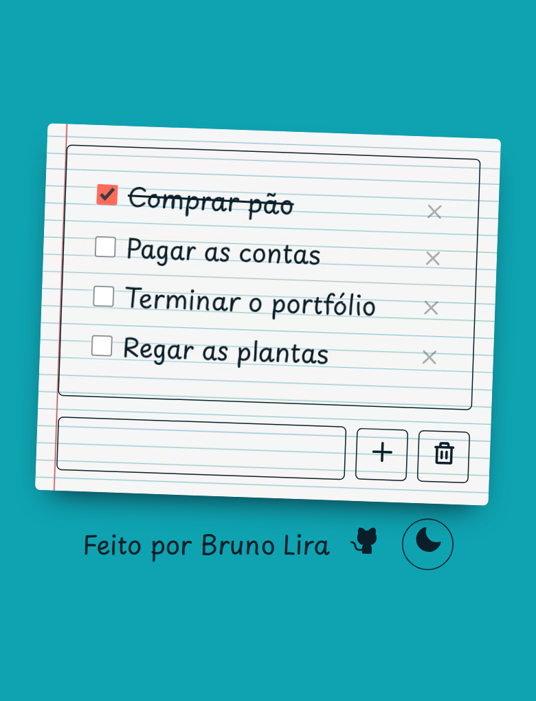
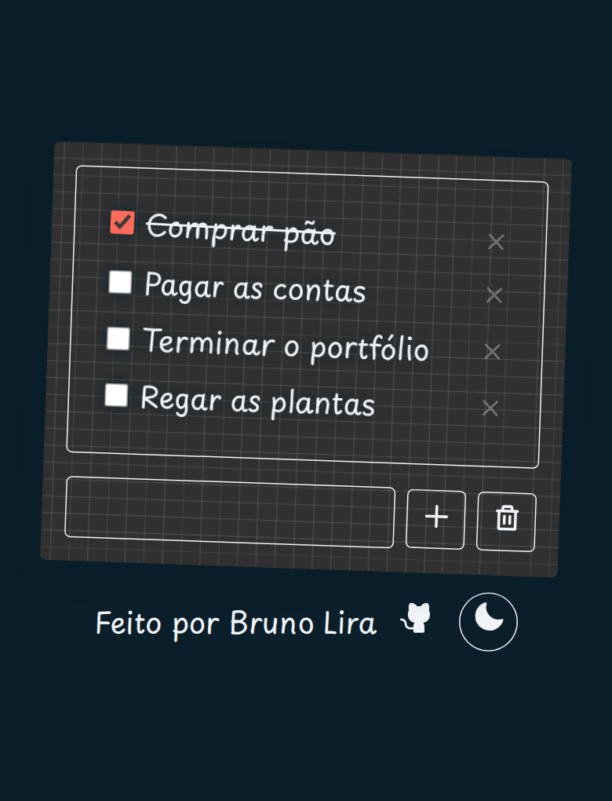

# To Do List

**Uma lista de tarefas que parece um bloquinho de papel — simples, rápida e offline, no claro e no escuro.**

| Claro | Escuro |
| :---: | :---: |
|  |  |

<p align="center">
  
  
  
</p>

## Sobre

Um app de lista de tarefas feito à mão em HTML, CSS e JavaScript puro — sem framework, sem bundler e sem dependências. O visual imita um bloquinho de papel: cartão levemente inclinado, textura, fonte manuscrita e microanimações nos itens. No tema claro, o papel pautado fica sobre uma mesa verde-água; no escuro, vira papel quadriculado sobre azul-marinho.

Os itens são salvos automaticamente no `localStorage` e o app funciona como PWA: pode ser instalado na tela inicial e aberto sem conexão.

## Funcionalidades

- **Adicionar tarefas** pelo botão **+** ou pressionando **Enter** no campo de texto.
- **Concluir e reabrir** itens pelo checkbox, com risco no texto ao marcar.
- **Tema claro e escuro** — o botão de lua no rodapé troca a paleta e a textura na hora, e a escolha fica salva para a próxima visita.
- **Excluir** um item pelo **×** ou **limpar a lista inteira** com o botão de lixeira.
- **Persistência automática** — a lista continua lá depois de fechar o navegador.
- **Offline** — o app shell (HTML, CSS, JS, manifest, ícones e as duas texturas) fica em cache pelo service worker.
- **Instalável** — manifest completo com ícones `any`, `maskable` e `apple-touch`.
- **Leve** — sem bibliotecas, sem requisições além da fonte.

## Tecnologias

| Camada | O que é usado |
| --- | --- |
| Interface | HTML + CSS (custom properties, nesting, `:has`, animações em `cubic-bezier`) |
| Lógica | JavaScript vanilla, `localStorage` |
| Offline | Service worker (network-first para navegação, stale-while-revalidate para assets) |
| PWA | `manifest.json`, ícones PNG em 192/512 px |
| Tipografia | [Playpen Sans](https://fonts.google.com/specimen/Playpen+Sans), via Google Fonts |

## Rodando localmente

```bash
git clone https://github.com/brunolieps/to-do-list.git
cd to-do-list
python3 -m http.server 8000
```

Depois abra <http://localhost:8000>.

> O service worker só é registrado em `http://localhost` ou em HTTPS. Abrir o `index.html` direto (`file://`) mostra a lista normalmente, mas sem cache offline e sem instalação como app.

## Instalar como aplicativo

- **Chrome / Edge no desktop:** clique no ícone de instalação na barra de endereço (ou menu → *Instalar To Do List*).
- **Android (Chrome):** menu ⋮ → *Adicionar à tela inicial* / *Instalar app*.
- **iPhone / iPad (Safari):** botão Compartilhar → *Adicionar à Tela de Início*.

## Estrutura do projeto

```text
.
├── index.html          # estrutura da página e ícones SVG inline
├── style.css           # tema, layout do bloquinho e animações
├── todo.js             # estado, persistência e renderização da lista
├── manifest.json       # metadados do PWA e ícones
├── service-worker.js   # cache do app shell para funcionar offline
├── icons/              # ícones 192/512, maskable, apple-touch e favicon
└── src/
    ├── paper01.png           # textura do tema claro (pautado)
    ├── paper02.png           # textura do tema escuro (quadriculado)
    ├── screenshot-light.png  # captura do tema claro
    └── screenshot-dark.png   # captura do tema escuro
```

## Design

O tema fica todo em variáveis CSS no topo de `style.css`:

| Token | Claro | Escuro | Uso |
| --- | --- | --- | --- |
| `--primary` | `#0fa3b1` | `#0b1f2a` | fundo da página |
| `--secondary` | `#f0f4f8` | `#0b1f2a` | papel do cartão e sombra dos itens |
| `--text` | `#0b1f2a` | `#f0f4f8` | texto, bordas e ícones |
| `--accent` | `#ff6b5b` | `#ff6b5b` | checkbox marcado, hover e seleção |
| `--shadow` | `#0b1f2a` | `#000000` | sombra do cartão |
| `--papertexture` | `paper01.png` | `paper02.png` | textura do papel |

Os ícones do app (pasta `icons/`) seguem a paleta clara: uma folha de papel com uma tarefa concluída em coral sobre o fundo verde-água.

## Tema claro e escuro

O botão de lua no rodapé alterna os temas em tempo de execução: o JavaScript reescreve as custom properties no elemento `<html>`, trocando as cores e a textura do cartão. O coral `#ff6b5b` continua como destaque nos dois temas.

A escolha é salva no `localStorage` (chave `darkmode`) e reaplicada no próximo carregamento. Sem preferência salva, o app abre no claro — ele ainda não segue o `prefers-color-scheme` do sistema (veja as limitações abaixo).

## Offline e cache

O service worker guarda uma lista fixa de arquivos (`APP_SHELL`) na instalação:

- navegação usa **network-first**, caindo para o cache quando não há rede;
- CSS, JS e imagens usam **stale-while-revalidate**, respondendo na hora e atualizando em segundo plano;
- as duas texturas de papel entram no cache, então o tema escuro também funciona offline.

Ao mudar qualquer arquivo da lista, **incremente `CACHE_NAME`** em `service-worker.js` (por exemplo, de `to-do-list-v4` para `to-do-list-v5`) para que os caches antigos sejam descartados na ativação.

## Limitações conhecidas

- Lista única: sem categorias, prazos, prioridades ou histórico.
- O app não segue a preferência do sistema (`prefers-color-scheme`): sem escolha salva, abre sempre no claro.
- O `id` de cada item é derivado do texto (`slugfy`), então **tarefas com nomes repetidos são ignoradas** e não existe edição — para renomear, exclua e crie de novo.
- O botão de lixeira apaga tudo imediatamente, **sem confirmação nem desfazer**.
- Os dados vivem no `localStorage` daquele navegador: não há sincronização entre dispositivos, e limpar os dados do site apaga a lista.
- A Playpen Sans vem do Google Fonts; na primeira visita sem rede, o app usa a fonte cursiva do sistema.
- Não há testes automatizados.

## Autor

Feito por **Bruno Lira** — [GitHub](https://github.com/brunolieps) · [Behance](https://behance.net/brunolieps)

Encontrou um bug ou tem uma sugestão? Abra uma [issue](https://github.com/brunolieps/to-do-list/issues).
